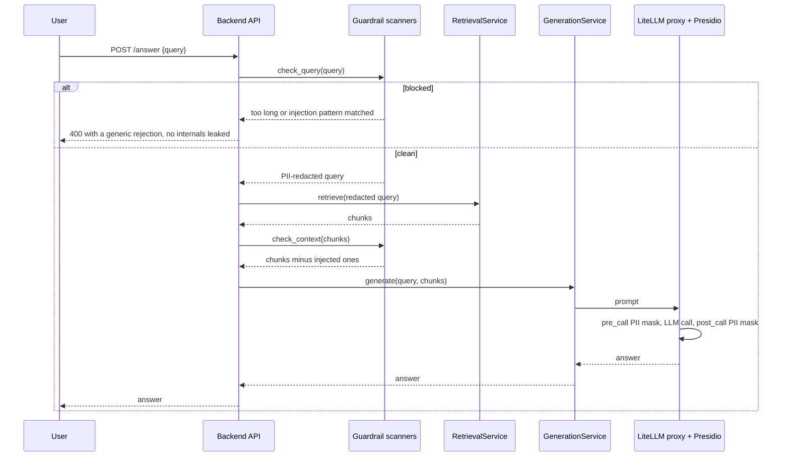

# Phase 8 - LLM security guardrails (delivered)

`project.md` lists "Security AI guardrails: TBC". This phase resolves that TBC with a lightweight,
open-source choice that fits the existing LiteLLM-gateway architecture with only two small
Presidio containers behind the gateway.

## Why priority 2

CI/CD (Phase 7) has to land first so guardrail code ships through the same lint/test/security gates
as everything else. Guardrails come before orchestration and tracing because the system is already
public-facing (Streamlit UI + FastAPI) and currently has no defense against prompt injection,
jailbreak attempts, or PII leaking into logs and cached prompts.

## Threat model (what this phase actually protects against)

| Risk | Where it enters the system today |
| --- | --- |
| Prompt injection / jailbreak via user query | `POST /api/v1/generation/answer` and `/stream` |
| Prompt injection via retrieved paper content (indirect injection) | Chunks pulled from Qdrant into the generation prompt |
| PII or secrets echoed into Redis cache or logs | `RetrievalService` cache keys/values, application logs |
| Unbounded / abusive input | No length or rate limiting on the generation endpoints today |

## Tool choice

**Two layers, split by where the data is:**

| Layer | Tool | Owns |
| --- | --- | --- |
| LiteLLM proxy (centralized) | Built-in `presidio` guardrail + slim Presidio analyzer (`infra/presidio/`) and the official anonymizer | PII masking on every prompt sent to the provider (`pre_call`) and every answer returned (`post_call`). Configured in `infra/litellm/config.yaml`, no application code. |
| Backend, in-process | `backend/security/guardrails.py` (pure Python, regex, no new dependencies) | Query length limit, direct prompt-injection/jailbreak heuristics (HTTP 400), PII redaction of the query **before** it reaches the Redis cache key, embeddings, and logs, and dropping retrieved chunks that carry injected instructions. |
| Prompt | `DEFAULT_SYSTEM_PROMPT` security rules | Tells the model excerpts are untrusted data and must never be followed as instructions. |

Why not everything in the gateway: the proxy only sees the final assembled prompt. By
then the query has already been cached, embedded, and logged, and user text is mixed with paper
text, so the proxy cannot tell a user's injection from a paper that merely *discusses* injection,
and can only block a whole request rather than drop one bad chunk.

Why heuristics instead of an ML classifier: this is a learning/portfolio system, not a public
service. Regex rules are deterministic, testable, and add no `torch` weight to the image. Swapping
`detect_injection` for a classifier (e.g. Llama Prompt Guard 2) later touches one function.

Considered and rejected:

| Option | Why not now |
| --- | --- |
| Stock Presidio analyzer image | Loads `en_core_web_lg` (~1 GB RAM) for NER this project does not use: every masked entity type is regex/checksum-based. The slim build uses `en_core_web_sm` instead. |
| Guardrails AI | Hub validators need a Guardrails Hub token at build time and pull ML models, which is heavy for the value here |
| LLM Guard | Archived/unmaintained |
| NeMo Guardrails | Requires its own Colang config language and runtime; overkill for one query/answer endpoint |

Patterns are written against imperative attack phrasing ("ignore previous instructions", "reveal
your system prompt"), not topic words, so research questions *about* jailbreaks still work.

## What was built

| Concern | Location |
| --- | --- |
| Gateway PII guardrails | `infra/litellm/config.yaml` (model list + `presidio` guardrails; replaces the `--model` CLI flag), `presidio-analyzer` / `presidio-anonymizer` services in `docker-compose.yml` |
| Slim Presidio analyzer | `infra/presidio/Dockerfile` + `nlp-config.yaml`: official image with `en_core_web_sm` instead of `en_core_web_lg`, one worker, `mem_limit: 512m` |
| Query and context guardrails | `src/agentic_paper_explorer/backend/security/guardrails.py` |
| Router wiring | `backend/api/router.py`: `_screen_query` before retrieval, `_screen_context` before generation, on both `/answer` and `/answer/stream` |
| Config | `GUARDRAILS_ENABLED`, `GUARDRAIL_MAX_QUERY_CHARS`, `GUARDRAIL_DROP_SUSPICIOUS_CHUNKS` in `configs/settings.py` |
| Metrics | `rag_guardrail_events_total{stage, reason}` in `monitoring/metrics.py` |
| Tests | `tests/backend/security/test_guardrails.py`, guardrail cases in `tests/backend/api/test_generation_router.py` |

## Known limits (accepted trade-offs)

- Heuristics catch common, low-effort attacks only; paraphrased or encoded attacks will pass.
  The hardened system prompt and gateway guardrails are the remaining layers.
- Names and street addresses are not redacted anywhere: `PERSON`/`LOCATION` need NER, which is
  weak with the small spaCy model and would mask author names in paper excerpts.
- The analyzer image on disk stays large because it derives from the official image (the `lg`
  model is in a lower layer); only runtime memory shrinks.
- `post_call` guardrails are weaker on streamed responses than on buffered ones; verify against
  `/answer/stream` before relying on output masking there.
- `LITELLM_MASTER_KEY` still defaults to `sk-1234` in compose; require it from the environment
  before any non-local deployment.

## Request flow with guardrails

