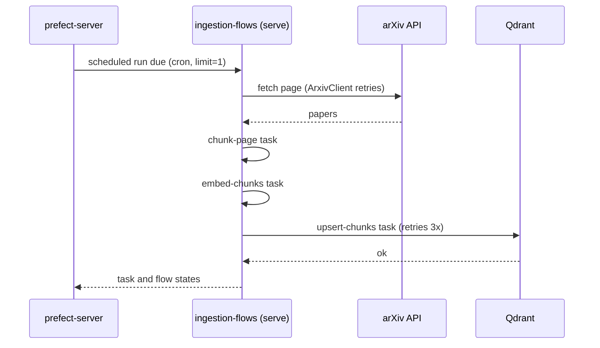

# Phase 9 - Ingestion orchestration (delivered)

`project.md` names ZenML, Hamilton, or Prefect as candidates and defers the choice. This phase makes
the choice and wires it into the one pipeline that needs it today:
[pipeline.py](../../src/agentic_paper_explorer/ingestion/pipeline.py).

## Why priority 3

Guardrails (Phase 8) protect the query path, which is user-facing and higher risk. Orchestration
protects the ingestion path, which already has retry/backoff logic
(`arxiv_max_retries`, `arxiv_retry_backoff_seconds`) but had no run history, no scheduling, and no
visibility into a partially-failed batch beyond application logs.

## Tool choice

**Prefect** (open source core, Apache-2.0), self-hosted as a `prefect-server` container plus one
`ingestion-flows` container that serves the scheduled deployments.

| Option | Trade-off for this project |
| --- | --- |
| **Prefect** (chosen) | Plain `@flow` / `@task` decorators over async Python. Ships a local UI for run history, per-task state, retries, and schedules, with no extra DSL to learn. |
| ZenML | Optimized for ML training pipelines (model registries, artifact stores); the ingestion pipeline here is closer to a data ETL job, so ZenML's MLOps surface is mostly unused weight. |
| Hamilton | Excellent for declarative dataframe/feature pipelines, but the pipeline here is I/O-bound (HTTP fetch, embed, upsert) and imperative already; Hamilton's function-as-node model would force more restructuring than Prefect's decorator approach. |

## What was built

| Concern | Location |
| --- | --- |
| Per-page step helpers (plain Python) | `ingestion/pipeline.py`: `chunk_page`, `embed_chunks`, `upsert_chunks`, `create_arxiv_client`, `create_repository` |
| Prefect tasks and flow | `ingestion/flows.py`: `chunk-page`, `embed-chunks`, `upsert-chunks` tasks and the `arxiv-ingestion` flow |
| Scheduled deployments | `ingestion/deployment.py`: one deployment per configured query, served with `prefect.serve(..., limit=1)` |
| Settings | `INGESTION_SCHEDULE_QUERIES` (JSON list), `INGESTION_SCHEDULE_CRON` (default `0 2 15 * *`, monthly on the 15th), `INGESTION_SCHEDULE_TIMEZONE` (default `UTC`), `INGESTION_SCHEDULE_MAX_RESULTS` (default `25`) in `configs/settings.py` |
| Compose services | `prefect-server` (`prefecthq/prefect:3.9.0-python3.12`, UI and API on `:4200`, SQLite in the `prefect_data` volume) and `ingestion-flows` (the `ingestion` image running `deployment.py`) |
| Tests | `tests/ingestion/test_flows.py` (runs against `prefect_test_harness`, no server needed), `tests/ingestion/test_deployment.py` |

## Design decisions

**The pipeline stays plain Python; the flow lives in its own module.** The obvious design is
`@flow` on `run_ingestion_pipeline` and `@task` on its helpers, but that function has two callers
with different needs. The on-demand API endpoint (`POST /api/v1/ingestion/papers/process`) and the
CLI must keep working without Prefect. A decorated flow called with no `PREFECT_API_URL` starts a
temporary local Prefect server, so every API request would become a tracked run and every pipeline
test would need the Prefect harness. Instead:

- `pipeline.py` holds the step logic as plain functions and its own short page loop.
- `flows.py` wraps those same functions in `@task`s and runs an equivalent loop inside `@flow`.

Only the ~15-line page loop is repeated. Chunking, embedding, point IDs, and payloads live once in
`pipeline.py`, so the two paths cannot drift on anything that matters.

**`serve()` instead of a work pool and worker.** Work pools suit many deployments across
infrastructure. For a few scheduled queries, one long-running process that registers the
deployments and executes their runs is enough, with nothing else to configure.

**Retries only where failures are transient.** `upsert-chunks` retries 3 times with a 5 second
delay; it is safe to repeat because collection creation is idempotent and point IDs are
deterministic (`uuid5` of paper ID and chunk index), so a re-run overwrites instead of
duplicating. arXiv fetching already retries inside `ArxivClient`, and an embedding failure is a
model problem, not a transient one.

**Scheduled runs fetch newest papers first; the API keeps relevance.** Without a sort order arXiv
ranks by relevance, so a recurring run for a broad query would re-fetch the same top hits every
month and rarely reach new papers. The flow passes `NEWEST_FIRST` (`sortBy=submittedDate`,
`sortOrder=descending`) to `iter_arxiv_papers`. The on-demand API sends no sort, because a user
searching wants the most relevant papers. The sort is an optional `ArxivSort` on
`ArxivClient.search_papers`, so omitting it leaves the request unchanged.

**`NO_CACHE` on every task.** Prefect's default cache policy hashes task inputs, which is slow for
embedding vectors and fails for the Qdrant client.

## Running it

```bash
docker compose up -d --build ingestion-flows   # also starts qdrant and prefect-server
docker compose exec ingestion-flows prefect deployment run \
  'arxiv-ingestion/all-retrieval-augmented-generation' -p max_total_results=3
```

Runs, task states, and schedules are visible at `http://localhost:4200`. Deployment names are the
query slugified (`all:"retrieval augmented generation"` becomes
`all-retrieval-augmented-generation`).

Verified locally: a 3-paper run completed with all three task runs completed, Qdrant grew from
4192 to 4245 points, and a repeat of the same run left the count unchanged (idempotent upserts).

## Known limits (accepted trade-offs)

- **Memory.** Each flow run loads its own copy of the embedding model (peak about 750 MiB in
  `ingestion-flows`; the Prefect server idles around 125 MiB). `limit=1` queues runs that share a
  cron time instead of running them concurrently, so a long query list delays later runs rather
  than multiplying memory. The full compose stack is heavy for small hosts (t2.micro class).
- **Monthly runs take only the newest `INGESTION_SCHEDULE_MAX_RESULTS` papers per query.** If a
  topic gets more new papers than that in a month (25 by default), the older ones in that month are
  skipped. Raise the cap or narrow the query if coverage matters more than run time.
- **SQLite run history.** Fine for one local server; a shared or production setup would point
  Prefect at Postgres.
- **No Prefect auth.** The self-hosted server and UI on `:4200` have no authentication; keep the
  port local.
- **The page loop exists twice** (`pipeline.py` and `flows.py`) by design; see above.
- **No Grafana metric for ingestion runs.** Prefect's UI covers run history and failures, so the
  planned `rag_ingestion_runs_total` counter was not added.

## Scheduled run flow


